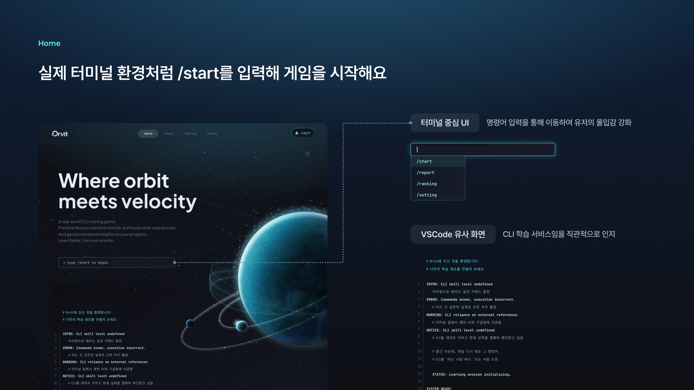
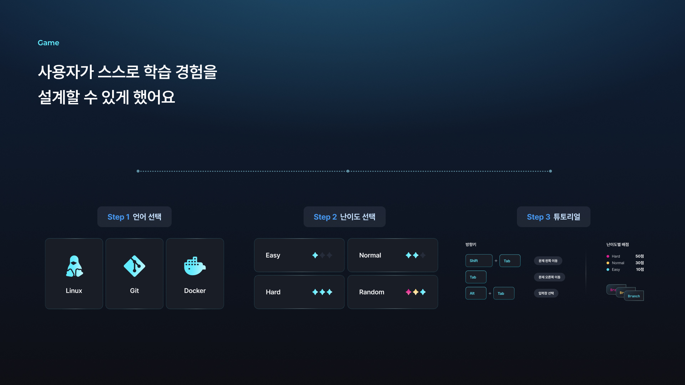
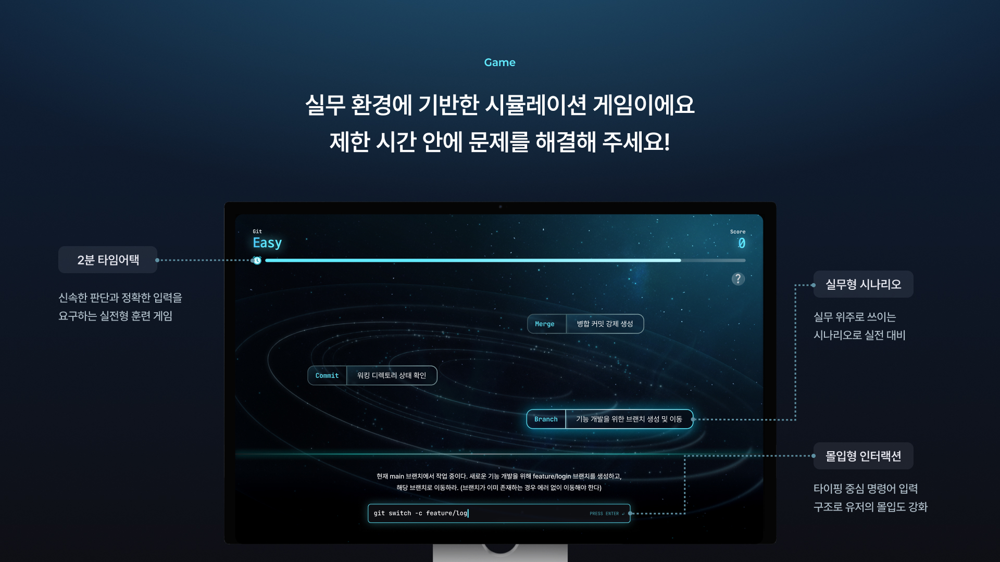
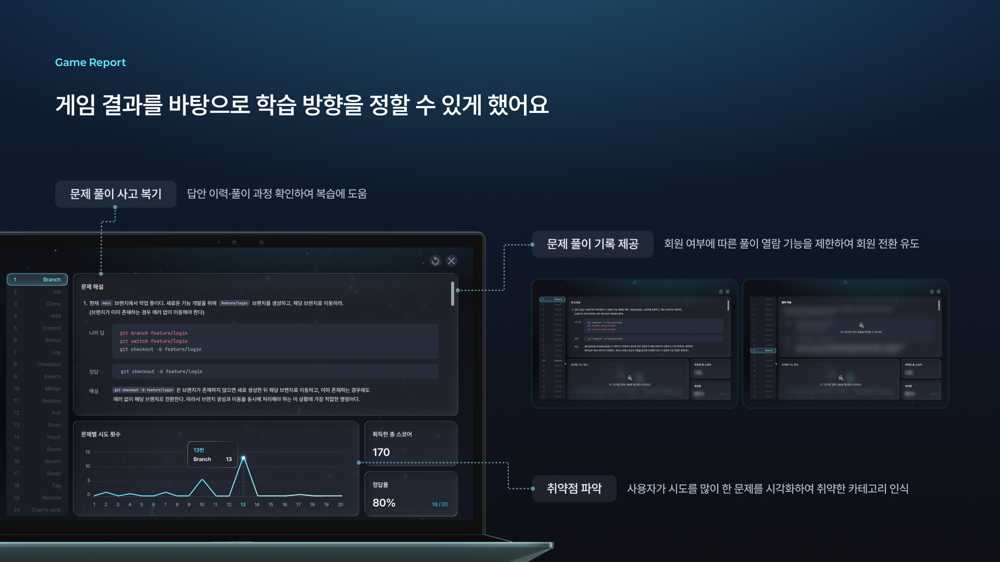
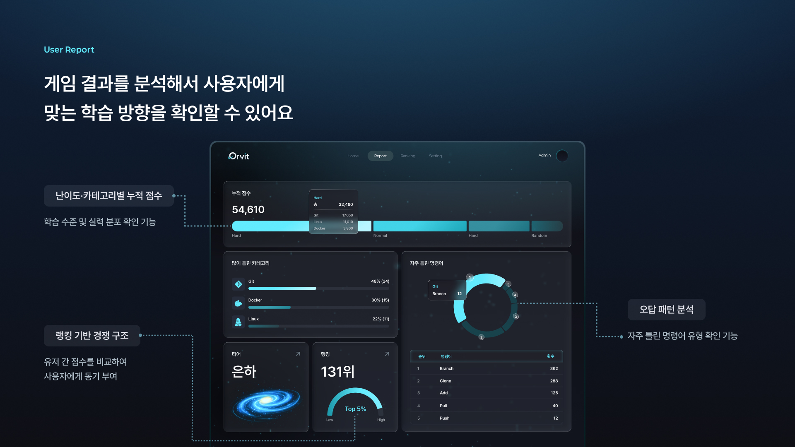
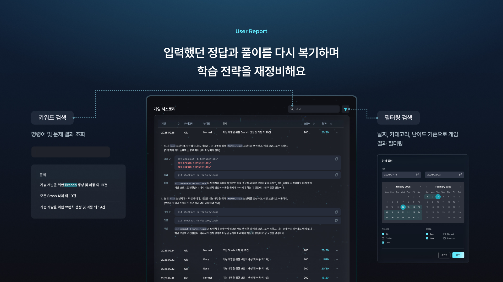
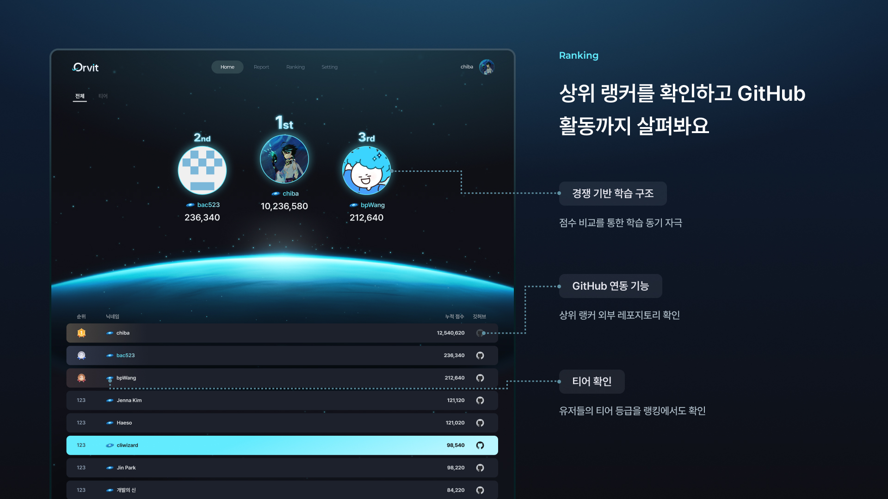

<div align="center">

# Orvit 🪐

### Git · Docker · SQL 명령어를 게임으로 익히는 타이핑 학습 서비스

명령어를 외우는 데서 그치지 않고, 상황에 맞는 명령어를 직접 입력하며 연습할 수 있습니다.

**[서비스 바로가기](https://orvit.net/)** · **[Frontend](https://github.com/dnd-side-project/dnd-14th-6-frontend)** · **[Backend](https://github.com/dnd-side-project/dnd-14th-6-backend)**



</div>

## 🪐 프로젝트 소개

Orvit은 Git · Docker · SQL 등 개발 과정에서 자주 쓰는 명령어를 **시나리오와 타이핑 게임**으로 학습하는 서비스입니다.

카테고리와 난이도를 선택하고 제한 시간 안에 명령어를 입력하며, 게임이 끝난 뒤에는 결과와 오답을 확인할 수 있습니다. 학습 기록과 랭킹을 통해 자신의 실력을 돌아볼 수도 있습니다.

## 🎮 주요 기능

| 기능 | 설명 |
| --- | --- |
| **명령어 게임** | 카테고리·난이도를 선택하고 타이핑으로 문제 풀이 |
| **게임 결과 리포트** | 게임 결과와 틀린 문제 확인 |
| **학습 분석** | 학습 기록과 자주 틀리는 명령어 확인 |
| **티어·랭킹** | 학습 결과에 따른 티어 및 사용자 랭킹 확인 |
| **소셜 로그인** | Google·GitHub 계정으로 로그인 |

### 서비스 화면

| 카테고리 선택 | 명령어 게임 |
| :---: | :---: |
|  |  |
| **게임 결과 리포트** | **학습 리포트** |
|  |  |
| **게임 히스토리** | **랭킹** |
|  |  |

## 🛠️ 프론트엔드 기술 스택

| 구분 | 기술 |
| --- | --- |
| **Framework** | Next.js 16, React 19, TypeScript |
| **서버 상태 관리** | TanStack Query v5 |
| **API 요청** | ky |
| **스타일링** | vanilla-extract |
| **개발 도구** | OpenAPI 기반 커스텀 Generator, Claude Code Skill |
| **코드 품질** | Biome, Husky, Commitlint |
| **패키지 관리** | pnpm |

## 📁 프론트엔드 구조

```text
.
├── .claude/
│   └── skills/
│       └── generate-api/         # API 코드 생성 Skill
├── docs/
│   ├── api-generation-guide.md   # API 생성·재생성 가이드
│   └── images/                   # README 서비스 화면 이미지
├── scripts/
│   ├── generate-api.cjs          # API 생성 전체 흐름
│   ├── generate-types.cjs        # DTO 타입 생성
│   ├── generate-hooks.cjs        # Query/Mutation Hook 생성
│   ├── swagger-transformer.cjs   # Swagger 명세 전처리
│   └── shared.cjs                # 공통 유틸리티
├── src/
│   ├── app/                      # 페이지·라우트
│   ├── components/               # UI 컴포넌트
│   ├── hooks/                    # Query/Mutation 등 훅
│   ├── server/                   # API 요청·Query 공통 코드
│   ├── types/                    # API DTO 및 타입
│   ├── styles/                   # 공통 스타일
│   └── utils/                    # 유틸리티
└── package.json
```

## ⚙️ API 코드 생성 도구

새로운 API를 연동할 때마다 DTO, Query Key, Query Hook을 작성하고 인증·응답·네이밍 규칙을 반복해서 확인해야 했습니다.

이 과정을 줄이기 위해 **OpenAPI 명세를 읽어 프로젝트 규칙에 맞는 코드를 생성하는 도구**를 구현했습니다. Orvit 프론트엔드 저장소 안에서 사용하는 개발 도구이며, 별도 패키지로 배포하는 CLI는 아닙니다.

```text
OpenAPI 명세 (한 번 조회)
          ↓
      generate-api.cjs
          ↓
    ┌─────┴─────┐
    ↓           ↓
DTO 타입 생성   Query/Mutation Hook 생성
    └─────┬─────┘
          ↓
   인증·응답·네이밍 규칙 적용
          ↓
     생성된 코드 확인
```

**주요 설계 내용**

- OpenAPI 명세를 한 번 가져와 **타입과 Hook 생성에 같은 명세**를 사용합니다.
- OpenAPI의 `security`를 기준으로 인증/비인증 요청 함수를 선택합니다.
- 공통 응답 구조를 전처리하고, Query의 `select`에서 실제 데이터를 꺼내도록 생성합니다.
- `--path`, `--tag` 옵션으로 필요한 API만 선택해 생성할 수 있습니다.
- 기존 Query Hook은 기본적으로 덮어쓰지 않습니다. 의도적으로 재생성할 때만 `--force`를 사용합니다.
- 생성되는 코드에는 Biome 검사 및 자동 수정이 적용됩니다.

### 사용 방법

```bash
# 특정 API의 타입과 Hook 생성
pnpm generate:api -- --path /api/games/options

# 특정 태그의 API 생성
pnpm generate:api -- --tag Games

# 전체 API 생성
pnpm generate:api

# 기존 Hook까지 다시 생성할 때 (수정 내용 덮어쓰기 주의)
pnpm generate:hooks -- --path /api/games/options --force
```

> DTO는 명세를 기준으로 갱신합니다. Query Hook은 화면에 맞게 수정할 수 있으므로 기존 파일을 기본적으로 유지합니다.

**관련 코드 및 가이드**

- [Generator 소스 코드](./scripts)
- [API 자동 생성 가이드](./docs/api-generation-guide.md)
- [Claude Code `generate-api` Skill](./.claude/skills/generate-api/SKILL.md)

## 🤖 Claude Code Skill

팀원들이 매번 API 경로나 생성 옵션을 확인하지 않아도 되도록 `generate-api` Skill에 실행 방법과 주의사항을 정리했습니다.

예를 들어 “게임 옵션 API 연동해줘”라고 요청하면, Claude Code는 Skill에 정리된 경로와 명령어를 참고해 Generator 실행을 도울 수 있습니다. **프로젝트 규칙에 따라 코드를 만드는 일은 Generator가 맡고, 화면별 Query 옵션과 사용 방식은 개발자가 결정합니다.**

## ✅ 코드 확인

생성 과정에서 Biome 검사를 적용하고, 생성 후에는 프로젝트에서 사용할 수 있는 코드인지 확인합니다.

```bash
# Biome 검사
pnpm check

# 프로젝트 빌드
pnpm build
```

타입 검사가 필요할 때는 TypeScript 컴파일러를 별도로 실행할 수 있습니다.

```bash
pnpm exec tsc --noEmit
```

> `generate:api` 명령이 TypeScript 검사와 전체 빌드까지 자동 실행하는 것은 아닙니다. 생성 결과를 확인하는 단계와 자동 생성 단계를 구분해서 사용합니다.

## 🚀 로컬 실행

**Node.js와 pnpm이 필요합니다.**

```bash
git clone https://github.com/dnd-side-project/dnd-14th-6-frontend.git
cd dnd-14th-6-frontend
pnpm install
pnpm dev
```

개발 서버는 기본적으로 [http://localhost:3000](http://localhost:3000)에서 확인할 수 있습니다.

API 연동과 인증 관련 기능을 실행하려면 프로젝트에 맞는 환경 변수 및 백엔드 연결 설정이 필요합니다. 필요한 값은 팀의 개발 환경 설정을 확인해 주세요. 민감한 환경 변수는 저장소에 커밋하지 않습니다.

## 🔗 관련 저장소

- **서비스:** https://orvit.net/
- **프론트엔드:** https://github.com/dnd-side-project/dnd-14th-6-frontend
- **백엔드:** https://github.com/dnd-side-project/dnd-14th-6-backend

---

<div align="center">

**명령어를 직접 입력하며 익히는 학습 서비스, Orvit**

</div>
